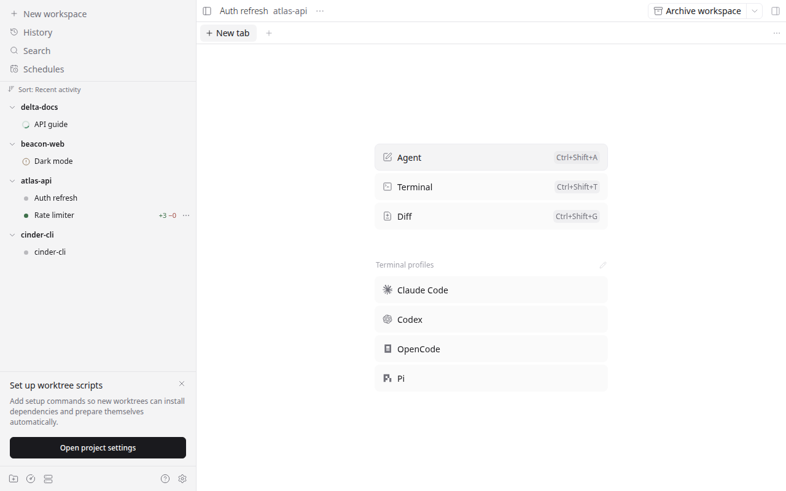
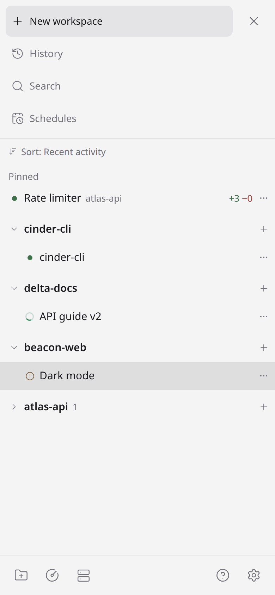

# Recent projects

A Paseo sidebar view ordered by what you touched last. Pinned workspaces come first, then projects
sorted by their most recently active workspace, each with its workspaces grouped underneath. It is a
replacement for Paseo's built-in sidebar, chosen per device.



## Requirements

Paseo 0.16 or newer on the daemon and on the app you use to connect to it.

## Install

```bash
paseo plugin add git:gengjiawen/paseo-recent-projects --ref v1.0.1
```

On the daemon, turn on **Enable plugins** under Settings → Plugins (or set the root
`pluginsEnabled` field in `config.json` and run `paseo reload`). Then pick **Recent projects** as the
sidebar view under Settings → Sidebar.

## What it does

- **Pinned section** at the top, with the project name shown next to each pinned workspace.
- **Project order** by recent activity (default), last prompt, or name. Recent activity uses the
  newest of a workspace's state change, last prompt, and creation time, so an agent that finishes a
  turn moves its project up.
- **Workspace order** by creation time (default), last prompt, or recent activity.
- **Three workspaces per project** by default, with a **Show more** row that expands the rest.
- **Per-project collapse**, stored per device.
- **Status indicators**: spinner for running, warning icon for waiting on input, colored dot for
  needs input / failed / done / idle.
- **Row actions** on hover (web) or always (compact and native): long-press menu with pin, rename,
  copy path, and archive.
- **Background workspaces** hidden unless you turn them on in the options menu, matching the built-in
  sidebar.



## Differences from the built-in sidebar

A project shows its icon when it has one: the uploaded image, or the same automatic favicon or
logo the built-in sidebar finds. Projects without an image stay as a name and a chevron. Relative
timestamps, project context menus, drag reordering, host and status filters, and keyboard
navigation are still missing. Preferences live on the device, like the built-in sidebar's display
settings.

## Development

```bash
npm install
npm run typecheck
npm test
```

The plugin reads workspace, project, and host metadata from the connected daemon. It makes no
network requests of its own and stores only its display preferences on the device.

## License

MIT
